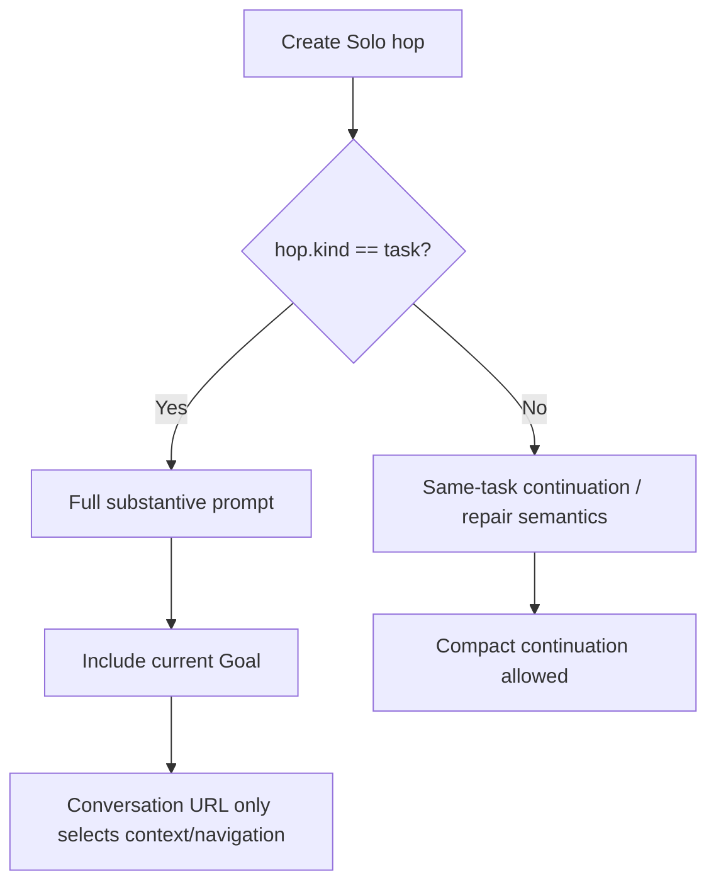

# Data Model: Solo Existing-Conversation Correctness

## Navigation URL

Represents the exact user-supplied ChatGPT location used to open an existing conversation.

**Fields**
- `raw_url`: non-empty user string after whitespace trimming.
- `scheme`: MUST be HTTPS.
- `host`: MUST be a supported ChatGPT host.
- `conversation_identity`: derived canonical `/c/<id>` identity.

**Validation**
- A recoverable conversation identity MUST be derivable from the URL path.
- The navigation URL is preserved; canonical identity is not substituted into navigation.

## Conversation Identity

Represents equality of ChatGPT conversations independently of route prefix.

**Shape**
- `/c/<conversation-id>`

**Rules**
- Short-form and project-scoped URLs ending in the same `/c/<id>` map to the same identity.
- Identity is comparison data, not a replacement navigation URL.
- Provisional local identities are not durable reopen identities.

## Solo Task Goal

Represents the current task's authoritative requested work.

**Fields**
- `goal`: current Goal text.
- `hop_kind`: task / repair / recovery kind.
- `conversation_url`: optional existing conversation navigation URL.

**Rules**
- `hop_kind == "task"` means first substantive prompt and MUST include the current Goal.
- Presence of `conversation_url` does not change a first task hop into a continuation.
- Later repair/continuation hops may use compact prompts according to their own kind.

## Durable Send Evidence

Represents proof about whether the new Solo prompt crossed the irreversible Send boundary.

### Pristine pre-boundary

All of the following hold:
- request status is NEW or PROMPT_SET;
- attempts == 0;
- no accepted timestamp;
- no binding;
- no baseline;
- no receipt;
- no upload receipt;
- no response;
- no prior session id;
- no durable error;
- hop has no receipt, message identity, or response;
- request id, prompt hash, role, and source context match the active hop.

### Crossed or ambiguous boundary

Any evidence contradicts the pristine conditions above.

**Rule**: Only pristine evidence may transition a `sending` hop into receiptless observation of a pre-existing response.

## Receiptless Existing-Response Observation

Uses the existing waiting hop plus `observed_existing_response = true`.

**Fields**
- `state = waiting`
- `receipt = null`
- `observed_existing_response = true`
- wait budget timestamps
- optional prepared prompt and pristine ledger record

**Semantics**
- The assistant response currently in the conversation belongs to prior conversation work.
- It MUST NOT be accepted, validated, repaired, or routed as the current Solo task's response.
- Observation only determines whether prior response activity is still active.

### Resume target after prior response ends

1. **No current prompt/request prepared** → `pre_send`.
2. **Current prompt + pristine zero-attempt request exist** → `sending`.
3. **Any inconsistent or post-boundary evidence** → fail closed using existing recovery/block semantics.

## Conversation Ownership

Represents durable control rights over a conversation.

**Live owner**
- task is non-terminal; and
- durable role metadata claims the canonical conversation identity.

**Historical owner**
- task is terminal but retains page/conversation metadata.

**Rules**
- Live foreign owner blocks concurrent control.
- Historical owner does not block explicit new Solo reuse by itself.

## State Transition Design

```mermaid
stateDiagram-v2
    [*] --> PreSend

    PreSend --> ObserveExisting: exact reused conversation is responding
    PreSend --> Sending: conversation ready; build full task prompt with Goal

    Sending --> ObserveExisting: responding race AND pristine zero-attempt evidence
    Sending --> Sent: current prompt accepted
    Sending --> ExistingRecovery: send boundary crossed or ambiguous

    ObserveExisting --> ObserveExisting: prior response still active
    ObserveExisting --> PreSend: prior response done; prompt not prepared
    ObserveExisting --> Sending: prior response done; prepared request still pristine
    ObserveExisting --> ExistingRecovery: durable evidence inconsistent

    Sent --> Waiting: wait for response bound to current receipt
    Waiting --> Responded: valid response bound to current request
    Responded --> [*]

    ExistingRecovery --> Waiting: existing exactly-once reconciliation proves accepted request
    ExistingRecovery --> [*]: explicit terminal block/repair outcome
```

## Prompt Semantic Decision

