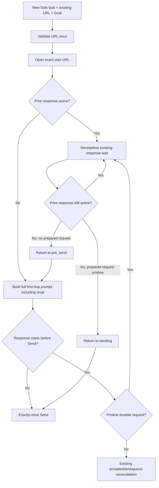

# Implementation Plan: Solo Existing-Conversation Correctness

**Branch**: `001-fix-solo-reuse` | **Date**: 2026-09-30 | **Spec**: [spec.md](spec.md)

**Input**: Feature specification from `specs/001-fix-solo-reuse/spec.md`

## Summary

Repair Solo Task reuse of existing ChatGPT conversations without adding a new orchestration layer. The change has three primary outcomes: accept project-scoped ChatGPT conversation URLs while preserving the exact user navigation URL; treat a pre-existing response as receiptless work to observe rather than an unsafe block when the current request is provably pre-Send; and ensure the first substantive prompt of a new Solo Task always carries the current Goal even when an older conversation is reused.

The implementation reuses the current conversation identity owner, the existing pristine-ledger predicate, and the existing receiptless waiting marker. It removes duplicated URL policy and the unused parallel existing-response marker instead of introducing new durable states.

## Technical Context

**Language/Version**: Python 3.11+

**Primary Dependencies**: Playwright async browser automation; existing CDPA worker/store/action/runtime modules; no new dependency

**Storage**: Existing JSON task manifests and per-task RequestLedger files under `.plan/` plus runtime event logs

**Testing**: pytest via `.venv\Scripts\python.exe -m pytest -q`

**Target Platform**: Current CDPA control runtime on Windows g6; code remains repository-compatible with supported Python platforms

**Project Type**: Browser-backed workflow control plane / CLI + local HTTP dashboard API

**Performance Goals**: No new global tab scans, no new polling loop, and no additional network round trip on normal idle Solo creation

**Constraints**: Exactly-once Send; exact endpoint/page/conversation ownership; preserve unrelated dirty/untracked work; no reset/stash/clean/push; no new durable state unless existing representation is insufficient

**Scale/Scope**: Five production boundaries at most: shared conversation URL/identity validation, Solo prompt semantic selection, receiptless existing-response observation/resume, terminal historical ownership filtering, and focused tests

## Constitution Check

*GATE: PASS before Phase 0; re-checked after Phase 1.*

- **I. Single Owner and Single Live Path — PASS**: URL validation is consolidated into the existing conversation identity owner; receiptless waiting reuses existing state/marker.
- **II. Exactly-Once Side Effects — PASS**: `sending -> receiptless wait` is permitted only when the existing pristine-ledger predicate proves zero attempts and no accepted/ambiguous evidence.
- **III. Exact Execution Identity and User Authority — PASS**: exact user URL remains navigation authority; canonical identity is comparison-only; real live ownership still fails closed.
- **IV. Regression Evidence Before Repair — PASS**: tasks require RED/GREEN coverage for URL, prompt, race, old-response suppression, and ownership safety.
- **V. Minimal Scope and Workspace Preservation — PASS**: no new service, state machine, dependency, or parallel validator; unrelated dirty work is preserved.

Post-design re-check: **PASS**. Phase 1 artifacts retain the same owners and do not introduce an exception to any principle.

## Project Structure

### Documentation (this feature)

```text
specs/001-fix-solo-reuse/
|-- spec.md
|-- research.md
|-- data-model.md
|-- quickstart.md
|-- contracts/
|   `-- solo-task-existing-conversation.md
|-- checklists/
|   `-- requirements.md
`-- tasks.md
```

### Source Code (repository root)

```text
src/playwright_auto/
|-- cdpa_commands.py      # canonical conversation identity + shared user URL validation
|-- dashboard_api.py      # Solo create-request boundary
|-- cdpa_store.py         # durable Solo task input normalization
|-- cdpa_prompts.py       # full task vs compact continuation rendering
|-- cdpa_worker.py        # Solo adoption, ownership, send-race observation/resume
|-- cdpa_actions.py       # exact URL adoption/reopen identity verification
`-- role_runtime/         # existing response signal/controller semantics; change only if required

tests/
|-- test_cdpa_solo_task.py
|-- test_cdpa_runtime_stability.py
|-- test_cdpa_actions.py
|-- test_cdpa_commands.py
|-- test_operator_resume_recovery.py
`-- test_cdpa_worker.py
```

**Structure Decision**: Keep the existing single Python package and existing state owners. Do not create a URL utility module or a new response-observation subsystem. `cdpa_commands.py` already owns canonical conversation identity and is imported by API, store, actions, and worker paths.

## Design

### 1. Consolidate user-supplied conversation URL validation

- Add one shared function beside `conversation_identity()` that validates/normalizes a user navigation URL.
- Required checks: non-empty HTTPS URL, supported ChatGPT host, recoverable non-provisional terminal `/c/<id>` identity.
- Return/persist the stripped original URL; do not canonicalize its route.
- Replace duplicate path-shape parsing in `dashboard_api.py` and `cdpa_store.py` with the shared function.
- Reuse the same identity semantics in actions/reopen validation rather than adding project-path special cases.

### 2. Separate new-task semantics from conversation reuse

- In Solo `_pre_send`, determine compact continuation from hop/task semantics, not from the presence of `conversation_url`.
- `kind == "task"` is the first substantive prompt and therefore `build_solo(... continuation=False)`.
- Existing repair/recovery hop kinds keep compact continuation behavior.
- Update tests that currently assert the wrong behavior for an idle reused conversation.

### 3. Unify pre-existing response observation

- Use `observed_existing_response` as the single receiptless-wait marker.
- Replace the currently unused `adopted_existing_response` path with the same observation helper.
- Initial already-responding adoption enters `waiting` without building/sending the new prompt.
- A ready-to-sending race may enter the same waiting state only after `_is_pristine_preboundary_sending_record()` proves the prepared request remains pre-boundary.

### 4. Do not consume the prior assistant response

- In `_waiting`, branch receiptless `observed_existing_response` before ordinary response routing.
- Observe only whether the exact page/transport remains active; never validate/accept the old assistant response as the new task result.
- When prior activity ends:
  - no prepared prompt/request -> return to `pre_send`;
  - prepared prompt + pristine ledger -> return to `sending` unchanged;
  - any inconsistent/post-boundary evidence -> fail closed through existing recovery semantics.
- Clear only observation-specific wait fields/marker when resuming the pending new task.

### 5. Preserve live ownership while ignoring terminal history

- In the foreign durable owner scan, skip terminal tasks.
- Keep non-terminal durable owners conservative/fail-closed even if their browser tab is temporarily unavailable.
- Do not allow explicit URL input to bypass a true live owner.

## Control Flow



## Phase 0: Research

Completed in [research.md](research.md). Key decisions: shared URL validator in the existing identity owner, first-hop task semantics independent of URL reuse, one receiptless observation marker, pristine-ledger guard for sending race, old-response suppression, and terminal-owner filtering.

## Phase 1: Design & Contracts

- [data-model.md](data-model.md) defines navigation URL vs canonical identity, Goal semantics, durable Send evidence, receiptless observation, ownership, and state transitions.
- [contracts/solo-task-existing-conversation.md](contracts/solo-task-existing-conversation.md) defines the user/API and runtime contract.
- [quickstart.md](quickstart.md) defines deterministic and runtime acceptance validation.

## Implementation Sequence

1. Add focused RED tests for URL project paths and navigation preservation.
2. Add RED tests proving reused first-hop prompt includes Goal.
3. Add RED tests reproducing the exact runtime race: hop `sending`, ledger NEW/attempts=0, page starts responding -> WAIT not BLOCK.
4. Add RED test proving receiptless old response cannot be accepted/routed as current task result and resumes pending Goal after inactivity.
5. Add RED ownership tests for terminal historical versus non-terminal live owner.
6. Implement shared URL validator and remove duplicate validators.
7. Fix Solo continuation discriminator.
8. Unify existing-response observation and guarded waiting->pre_send/sending resume.
9. Filter terminal historical owners.
10. Run focused tests, recovery regressions, full suite if warranted, and `git diff --check`.

## Complexity Tracking

No constitution violations or additional complexity budget are required. The plan introduces no new durable state, service, dependency, or parallel ownership implementation.
